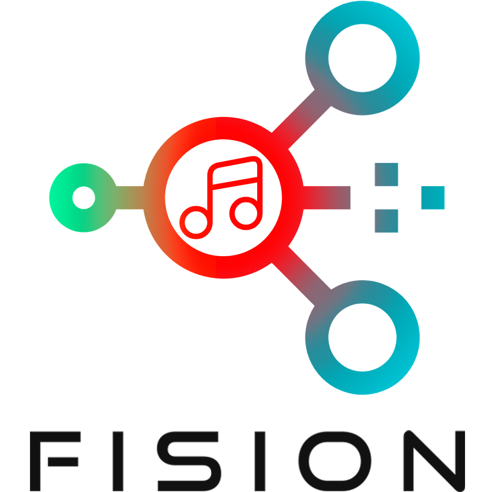
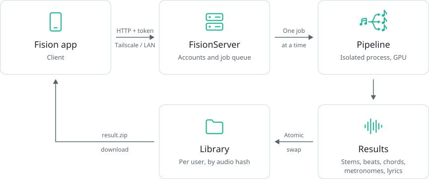

<div align="center">
  <picture>
    <source media="(prefers-color-scheme: dark)" srcset="./docs/readme/title_dark.png">
    
  </picture>
  <p><b>The magic starts with the fision of your music.</b></p>
  <p>
    
    
    
    
    <a href="https://github.com/jotapemj/FisionApp-Android"></a>
    <a href="LICENSE"></a>
  </p>
</div>

FisionServer is the self-hosted backend of Fision. A song sent from the
[Fision app](https://github.com/jotapemj/FisionApp-Android) comes back as
separate stems with beats, chords, metronomes and lyrics, all processed on
the server's own GPU. Accounts, library and models stay on the host that runs
it.

## What it does

* **Stem separation**: vocals, lead and backing vocals, bass, drums or the
  full kit split into pieces, guitar, piano and winds.
* **Beats and downbeats**, with the time signature detected.
* **Chords** synchronized to the beat, in MusGlyphs notation.
* **Metronomes** at half, normal and double speed.
* **Synced lyrics** on demand, word by word, in 99 languages.
* **Cover art and tags** read from the original file.

## Also

* **Multi-user**: each account has its own library, playlists and avatar.
* **Processed once**: a song already in the library downloads again without
  reprocessing.
* **Safe reprocessing**: a failed or cancelled job never destroys the
  previous result.
* **Shared GPU queue** that waits for free VRAM and survives restarts.
* **Admin panel** in the browser, in 10 languages.
* **Desktop GUI and command line** to run the pipeline without the server.

## Getting started

1. Install the server on a Linux machine with an NVIDIA GPU (see
   [Install](#install)). It also runs on the CPU, much slower.
2. Check the installation with `python -m fision_server.doctor` and download
   every model up front with `python -m fision_server.prefetch` (several GB).
3. Create the first account, which becomes the administrator:
   `python -m fision_server.useradd <name>`.
4. Start the server: `python -m fision_server.run`. It listens on port 8000.
5. Install the [Fision app](https://github.com/jotapemj/FisionApp-Android) and
   sign in with the server address and the account.

> [!WARNING]
> The server speaks plain HTTP. Reach it through
> [Tailscale](https://tailscale.com) or the local network, never directly
> from the internet.

The [server reference](docs/REFERENCE.md) covers configuration, the
HTTP API, the admin panel and deployment as a systemd service. When
something does not work, `python -m fision_server.doctor` is the first step:
it names the problem and the fix.

## How it works

<div align="center">
  <picture>
    <source media="(prefers-color-scheme: dark)" srcset="./docs/readme/architecture-dark.svg">
    
  </picture>
</div>

* **Server** (`fision_server/`): accounts, job queue and the per-user
  library, where each song is stored under the hash of its audio.
* **Pipeline** (`headless_fisionAI.py`): the audio work, run as an isolated
  process per job. The server, the GUI and the CLI all call the same
  pipeline.

<details>
<summary><b>The pipeline in detail</b></summary>

**Stem separation** runs a fixed model chain on the GPU through
`audio-separator`: a RoFormer splits vocals and instrumental, HTDemucs `ft`
gives bass and drums, HTDemucs `6s` gives guitar and piano, an MDX23C drum
separator can split the kit, and a wind model pulls brass and woodwinds.
`other` is always derived by subtraction.

**Beats and downbeats** come from beat_this (ISMIR 2024), on the CPU and in
parallel with the separation. The frame-level logits of the three published
checkpoints are averaged and decoded by madmom's Dynamic Bayesian Network,
which tracks beats and downbeats jointly. The time signature is detected
between 3/4 and 4/4, from 55 to 215 BPM.

**Chords** come from BTC, a Transformer with a 170-chord vocabulary, included
as a git submodule. BTC labels frames of about 0.09 s without knowing the
beat, so dense mixes flicker between a chord and its seventh (`C`, `C7`,
`C`). Fision synchronizes the result to the beats:

1. Frame probabilities are averaged within each beat.
2. A Viterbi pass over the beats picks the most likely sequence, with a cost
   for every change. Changes are cheaper on the downbeat and at half-bar,
   and much cheaper within a chord family (same root and triad: `C`, `C7`,
   `Cmaj7`, `C6`).
3. Consecutive chords of the same family are merged and labeled with the
   member that accumulates the most probability.

Chords therefore change only on beats. The `FISION_CHORDS_*` variables set
the strength, and `FISION_CHORDS_SMOOTH=0` restores the raw BTC output.

**Lyrics** are opt-in and outside the main pipeline. Whisper (through
`faster-whisper`) transcribes the isolated vocals with word timestamps, and
the result is split into lines for karaoke. The model is loaded per request,
so it does not hold VRAM between jobs.

</details>

## Install

```bash
# 1. Clone WITH submodules (BTC lives as a submodule, weights included)
git clone --recurse-submodules https://github.com/jotapemj/Fision-Server.git
cd Fision-Server
# (if cloned without --recurse-submodules)
git submodule update --init --recursive

# 2. System deps (not pip): audio, desktop GUI, and the compiler madmom needs
sudo apt install ffmpeg python3-tk build-essential python3.12-dev

# 3. Python 3.12 virtual environment
python3.12 -m venv venv
source venv/bin/activate            # Windows: venv\Scripts\activate

# 4. PyTorch FIRST, from the index for the GPU (see below)
pip install torch==2.13.0 torchaudio==2.11.0 torchvision==0.28.0 --index-url https://download.pytorch.org/whl/cu129

# 5. Everything else, at the validated versions
pip install -r requirements.txt -c constraints.txt
```

### Choosing the PyTorch index

The index depends on the GPU generation and the NVIDIA driver. All of them
use CUDA 12, the version faster-whisper (lyrics) is built for, so PyTorch
and Whisper share one set of CUDA libraries.

* **`cu129`**: Turing and newer (RTX 20xx to 50xx), driver 575 or newer.
  This is the validated configuration.
* **`cu126`**: Maxwell, Pascal and Volta (GTX 9xx, GTX 10xx, V100), driver
  560 or newer. Not tested on real hardware.
* **`cpu`**: no NVIDIA GPU. Much slower.

Check the driver with `nvidia-smi` and the result with
`python -c "import torch; print(torch.cuda.is_available(), torch.cuda.get_arch_list())"`.
`torchaudio` stays at 2.11.0: no newer release exists, and only `beat_this`
uses it.

> [!NOTE]
> On Pascal and older cards, set `FISION_WHISPER_COMPUTE=int8` and
> `FISION_SEP_AUTOCAST=0`. These GPUs have no fast fp16: Whisper would fall
> back to fp32, and the separator runs slower with autocast.

`requirements.txt` lists the direct dependencies and `constraints.txt` pins
everything else to the validated stack, so two installs made months apart
get the same versions. Do not add `nvidia-*` packages by hand: PyTorch
brings the CUDA libraries.

### Model weights

The separation models, the Whisper checkpoint and the `beat_this`
checkpoints download automatically on first use. The BTC weights ship inside
the submodule, so a recursive clone already has them.

`FISION_MODELS_DIR` keeps all weights under a single root:

* `separator/`: `audio-separator` models. Overridden by
  `FISION_SEP_MODEL_DIR`.
* `hf/`: Whisper. Overridden by `HF_HOME`.
* `torch/`: `beat_this` checkpoints. Overridden by `TORCH_HOME`.

Without it, each library keeps its usual default under `~/.cache`.

> [!NOTE]
> Separation weights take several GB. Keep them on a persistent disk, never
> on a RAM-backed `/tmp`.

## Without the server

The pipeline also runs on its own, for quick tests or a single song.

**Desktop GUI.** Runs the pipeline on one file. By default it writes to a
plain folder; the *save like the server* option stores the result in the
library instead (`FISION_LIBRARY`, owner `FISION_LOCAL_USER`). It needs a
graphical environment.

```bash
python headless_fisionAI_gui.py
```

**Command line.**

```bash
python headless_fision_CLI.py <input_audio> <output_dir> [config.json] [--device cpu|cuda]
python headless_fision_CLI.py <input_audio> [config.json] --save-server   # into the library
```

**Lyrics.** Once a song has a `vocals.flac`, the same transcription the
server uses writes `lyrics.json` into `<output_dir>`. `language` is an ISO
code (`en`, `es`, `fr`...); omit it or pass `auto` to detect it.

```bash
python headless_fision_lyrics_CLI.py <vocals.flac> <output_dir> [language]
```

## Credits

Fision builds on these projects. Each keeps its own license; check upstream
before redistributing.

**Separation and analysis**

- [audio-separator](https://github.com/nomadkaraoke/python-audio-separator):
  RoFormer, Demucs and MDX models. MIT. The model weights are downloaded on
  first use (or with `prefetch`) and keep the licenses set by their authors.
- [beat_this](https://github.com/CPJKU/beat_this), Foscarin, Schlüter and
  Widmer (CPJKU, ISMIR 2024): beats and downbeats. MIT. Its checkpoints are
  downloaded from CPJKU on first use.
- [madmom](https://github.com/CPJKU/madmom), CPJKU / OFAI: Dynamic Bayesian
  Network tracker. Source code BSD 2-Clause. The model files bundled with
  madmom (CC BY-NC-SA 4.0) are not used by Fision.
- [BTC](https://github.com/jayg996/BTC-ISMIR19), Jonggwon Park et al., *A
  Bi-Directional Transformer for Musical Chord Recognition* (ISMIR 2019):
  chords, through a compatibility fork. MIT.
- [Whisper](https://github.com/openai/whisper), OpenAI, through
  [faster-whisper](https://github.com/SYSTRAN/faster-whisper): lyrics. MIT.

**Server**

- FastAPI, Uvicorn, argon2-cffi, PyJWT and mutagen.
- [Noto Sans](https://github.com/notofonts/latin-greek-cyrillic): admin
  panel font. SIL Open Font License.
- [Material Icons](https://fonts.google.com/icons): admin panel icons.
  Apache 2.0.

## License

Copyright (C) 2026 Jotapeveloper

FisionServer is licensed under the
[GNU Affero General Public License v3.0](LICENSE) (AGPL-3.0). Running a
modified version as a network service requires making its complete source
code available to the users of that service.

The BTC submodule keeps its original MIT license.
